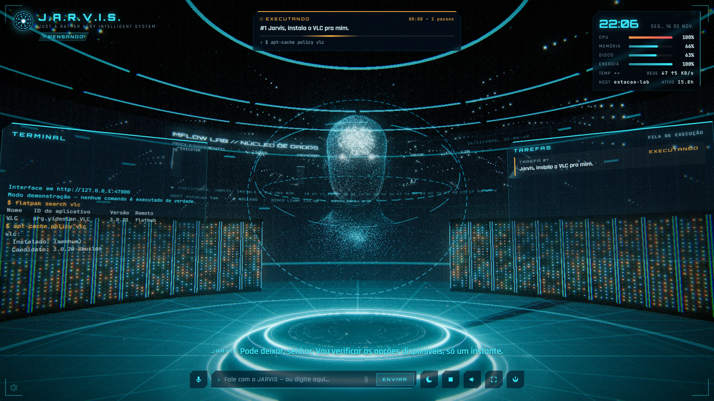
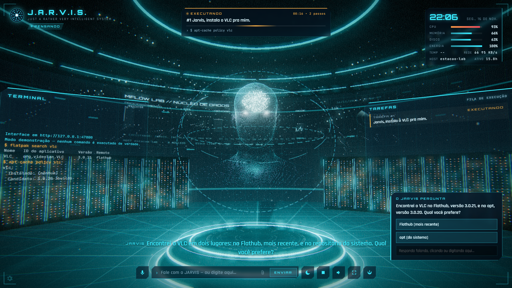
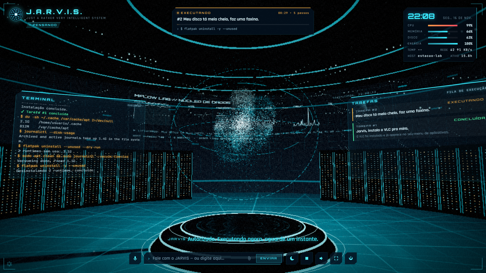
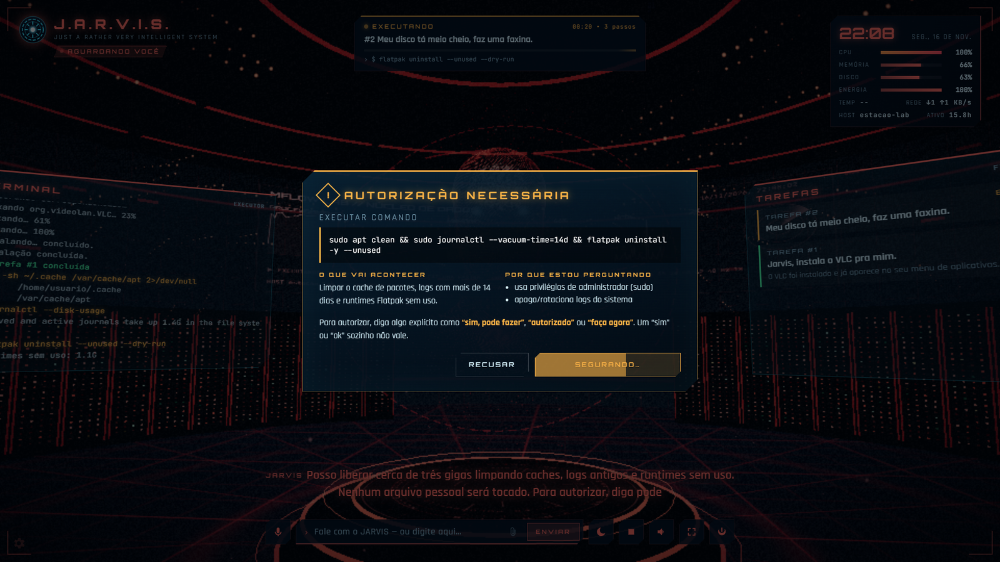
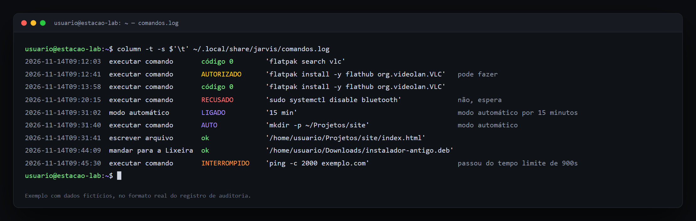
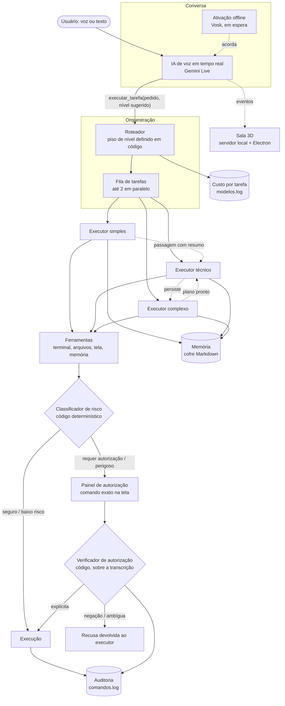

<h1 align="center">JARVIS</h1>

  <b>Assistente pessoal por voz que executa tarefas reais no computador, com autorização verificada por código.</b> 
  O laboratório de P&D onde testo arquiteturas de agentes de IA antes de levá-las a projetos de clientes.

  
  
  
  
  
   
  
  
  
  
  

---

## O problema

Toda empresa que pensa em colocar um agente de IA para **agir** (e não só responder) esbarra nas mesmas três perguntas:

- **Segurança:** o que impede a IA de apagar, instalar ou alterar algo que não devia? Confiar no "bom senso" do modelo não basta, porque um modelo pode errar ou ser induzido por um site ou arquivo malicioso.
- **Custo:** usar o modelo mais caro para tudo funciona, mas a conta cresce rápido. Usar o mais barato para tudo economiza, mas falha nas tarefas difíceis.
- **Rastreabilidade:** quando algo dá errado, é preciso saber o que foi executado, quem autorizou e quanto custou.

Essas respostas precisam estar resolvidas **antes** de um agente chegar à operação de um cliente. O JARVIS é onde elas são testadas.

## A solução

O JARVIS é um assistente de voz para Linux e macOS que conversa em tempo real e executa tarefas de verdade pelo terminal: instala e remove aplicativos, faz limpeza do sistema, verifica disco, rede e atualizações, abre programas, cria e edita arquivos.

Por trás da conversa existe uma arquitetura de agentes com responsabilidades separadas:

- **Uma IA de voz** conversa, entende o pedido e conta o resultado.
- **Três modelos executores**, de custo crescente, fazem o trabalho. Cada pedido vai para o mais barato que dá conta dele, e um executor passa a tarefa para outro quando ela muda de dificuldade.
- **Código determinístico**, e não a IA, decide o que é perigoso e se o usuário realmente autorizou.
- **Tudo fica registrado:** cada comando, cada autorização ou recusa e o custo de cada tarefa.

É um projeto de P&D: os padrões validados aqui (roteamento por complexidade, guarda-corpos em código, auditoria) são os mesmos que aplico nas automações com IA para empresas.

---

## Funcionalidades

### Conversa por voz em tempo real
- Conversa falada com resposta em áudio, legendas na tela e caixa de texto como alternativa.
- **Interrupção:** com fone de ouvido (modo *full duplex*), dá para cortar o JARVIS no meio da fala. Sem fone, o microfone fica mudo enquanto ele fala, para ele não ouvir a própria voz.
- **Tarefas em segundo plano:** a conversa continua enquanto a tarefa roda. Ele dá atualizações curtas em tarefas longas, aceita complementos no meio ("só leitura, hein") e faz perguntas nos pontos de decisão, com opções clicáveis.
- **Até 2 tarefas em paralelo** (configurável), cada uma com seu executor, e uma autorização por vez na tela.
- **Modo de espera com ativação offline:** em espera, a conexão com a IA é desligada e a palavra "Jarvis" é reconhecida localmente, sem enviar áudio para lugar nenhum.

### Roteamento de cada pedido para o modelo certo
- Três níveis de executor: **simples** (consultas, abrir apps, achar arquivos), **técnico** (instalar, configurar, programar, logs) e **complexo** (planejamento, arquitetura, problemas persistentes).
- O código define um **piso** pelo conteúdo do pedido: um pedido técnico nunca vai para o nível simples, mesmo que a IA de voz ache que é fácil. Pedidos evidentemente complexos vão direto ao nível mais alto, sem gastar tokens nos outros antes.
- **Passagem entre executores:** o simples passa ao técnico o que for técnico, o técnico chama o complexo só quando o problema persiste, e o complexo pode planejar e devolver a execução. A passagem leva um resumo do que já foi feito, não o histórico inteiro, com **no máximo 3 passagens por tarefa**.
- **Custo medido por tarefa:** modelos usados, tokens (inclusive em cache), custo estimado em dólar, tempo e passagens ficam em um log próprio.

### Ações sensíveis só com autorização explícita
- Cada comando passa por um **classificador de risco** com quatro níveis: seguro, baixo risco, requer autorização e perigoso.
- Antes de qualquer ação que exige autorização, o JARVIS explica em voz alta o que vai fazer e o risco, e mostra o **comando exato** num painel. A sala fica vermelha.
- Valem só autorizações **explícitas** ("pode fazer", "autorizado", "sim, faça agora"). "Sim" ou "ok" sozinhos não valem, qualquer negação vale como recusa e uma pergunta não conta como autorização. Na tela, a alternativa é **segurar** o botão de autorizar por 1,5 segundo.
- Uma autorização captada enquanto o próprio JARVIS fala é descartada, porque pode ser eco da voz dele. Três respostas ambíguas seguidas cancelam o pedido.
- Quando um comando precisa de `sudo`, a senha é pedida num painel próprio e vai direto para o sistema: **a IA nunca vê a senha**.

### Modo automático com limites
- "Modo automático por 15 minutos" libera a execução sem pedir autorização durante o tempo pedido (até 4 horas), com um contador na tela.
- Mesmo no automático, a **senha de administrador** e as **ações críticas e irreversíveis** (formatar discos, apagar pastas do sistema ou a pasta pessoal, mudar senhas e usuários) continuam sendo pedidas.
- Só o usuário liga o modo automático, pela fala ou pelo texto. A IA não consegue ligá-lo sozinha, nem se um site ou arquivo tentar induzi-la a isso.

### Auditoria
- **Todo comando executado** é registrado com data, hora e resultado (código de saída, cancelamento ou tempo esgotado).
- Cada **autorização e recusa** é registrada junto com a frase que o usuário disse. Ações liberadas pelo modo automático ficam marcadas como `AUTO`.
- Escrita, edição, cópia, movimentação e envio de arquivos para a lixeira também entram no registro. Quando o JARVIS sobrescreve um arquivo, o original é guardado como cópia de segurança.

### Memória de longo prazo
- O JARVIS lembra das conversas, decisões e pendências entre um dia e outro, num cofre de notas em Markdown que abre no Obsidian.
- Um consolidador lê periodicamente o trecho novo da conversa e grava resumo, decisões, pendências (com data) e fatos novos nas notas certas.
- O executor guarda **habilidades**: receitas do que aprendeu fazendo, com os passos e armadilhas, e as corrige quando algo falha.
- **Senhas e chaves nunca vão para a memória:** o código recusa o que parecer um segredo.

### Rotinas e ferramentas próprias
- **Rotinas:** lembretes e tarefas agendadas (todo dia, em dias da semana, a cada N minutos ou numa data), editáveis como notas.
- **Ferramentas criadas pelo próprio JARVIS:** scripts reaproveitáveis guardados no cofre. Os argumentos entram como dados, nunca colados no meio do código, e cada uso passa pelo classificador de risco como qualquer comando.

### A sala 3D
- Interface em WebGL com um **holograma de partículas** que muda de forma conforme o estado: um rosto quando conversa, o cérebro aceso quando pensa, um núcleo de processamento quando executa e uma esfera quando está em espera.
- Painel de comandos ao vivo, fila de tarefas, andamento da tarefa atual e telemetria real do computador (CPU, memória, disco, rede, bateria e temperatura).
- A qualidade gráfica se ajusta sozinha a placas de vídeo modestas.

### Laboratório de produção de comerciais
Um módulo experimental, ainda em construção, conduz a produção de um vídeo curto de produto: briefing, roteiro, elenco e storyboard, geração das cenas, revisão visual automática das tomadas e montagem. As etapas de imagem e vídeo, que geram custo, pedem autorização com o valor estimado. É onde testo fluxos de vários agentes com revisão de qualidade entre as etapas.

---

## Arquitetura

| Parte | Papel |
|---|---|
| **IA de voz** | Conversa em tempo real e responde em áudio. Responde direto só a cumprimentos e conversa social; o resto vai para os executores, e ela conta o resultado sem mudar dados nem conclusões. |
| **Roteador** | Escolhe o executor de cada tarefa. Vale o maior entre o palpite da IA de voz e o que o código reconhece no pedido. Controla as passagens e registra o custo. |
| **Executores** | Três modelos da OpenAI com níveis de raciocínio e preço diferentes. Rodam comandos, leem a saída, corrigem erros e conferem o resultado. Podem pesquisar na web. |
| **Classificador de risco** | Analisa o comando completo (encadeamentos, redirecionamentos, substituições, `sudo`, interpretadores) por lista de permissão: o que não é reconhecido como seguro pede autorização. Regras próprias para Linux e macOS. |
| **Verificador de autorização** | Decide, pela transcrição da fala ou pelo texto, se houve autorização explícita, recusa ou resposta ambígua. A IA não participa dessa decisão. |
| **Auditoria** | Registro de cada comando, ação em arquivos, autorização, recusa e ação do modo automático. Um segundo log guarda custo, tokens e tempo de cada tarefa. |
| **Memória** | Cofre de notas Markdown com conversas, diário, decisões, pendências, perfil e habilidades aprendidas. |
| **Interface** | Servidor local que transmite os eventos ao vivo para a sala 3D, empacotada como app desktop com o núcleo Python embutido. |

---

## Decisões técnicas

1. **A IA não decide se o usuário autorizou.** A verificação é feita por código sobre a transcrição: lista de frases explícitas, negações que sempre recusam, perguntas que nunca autorizam e descarte de fala captada enquanto o próprio assistente fala. Assim, um modelo induzido por um site ou arquivo não consegue "se autorizar".

2. **Risco classificado por lista de permissão, não por lista de proibição.** O classificador é determinístico e conservador: o que ele não reconhece como seguro pede autorização. O modelo também não escolhe o texto que é avaliado. Em ferramentas criadas pela própria IA, o que se avalia é o script final, com os valores já no lugar.

3. **Roteamento com piso em código.** A IA de voz sugere o nível, mas o código nunca deixa um pedido técnico ir para o executor mais barato. Isso evita o pior dos dois mundos: tarefa difícil falhando no modelo fraco, ou tarefa trivial gastando no modelo caro. As passagens levam um resumo, não o histórico, e têm limite para não virar pingue-pongue.

4. **Segredos fora do alcance da IA.** A senha de administrador vai do painel direto para o `sudo`, por um canal privado que só atende processos do comando em execução. Ela fica só na memória do programa, por poucos minutos. As chaves de API são removidas do ambiente dos comandos, para que um simples `env` não as envie ao modelo. A memória recusa gravar o que parece senha ou chave.

5. **Interface local fechada.** O servidor da interface só escuta no próprio computador, exige um token aleatório gerado a cada execução e confere a origem da conexão. Outro site aberto no navegador não consegue conversar com o JARVIS.

6. **Testes como portão de entrega.** Os testes rodam sem rede, com substitutos dos SDKs de IA, e o script de empacotamento aborta se algum falhar. Nenhuma versão do app é gerada com teste quebrado.

---

## Tecnologias

| Camada | Tecnologias |
|---|---|
| Voz | Gemini Live (áudio bidirecional em tempo real), PipeWire no Linux, PortAudio no macOS |
| Ativação offline | Vosk com modelo pequeno de português |
| Executores | API da OpenAI, com três modelos em níveis de custo e raciocínio diferentes e busca na web |
| Núcleo | Python 3.11+, asyncio, aiohttp (servidor local e WebSocket) |
| Interface | Three.js (WebGL, partículas, pós-processamento), HTML e CSS |
| App desktop | Electron, núcleo empacotado com PyInstaller; `.deb` e AppImage (Linux), `.dmg` (macOS Apple Silicon) |
| Memória | Notas Markdown compatíveis com Obsidian |
| Mídia (módulo experimental) | ffmpeg, geração de imagem e vídeo por API |
| Testes | unittest, com substitutos dos SDKs de IA (sem rede) |

---

## Qualidade e segurança

- **190 testes automatizados**, organizados por área: voz e conversa, roteamento entre executores, classificador de risco e verificação de autorização, tarefas em paralelo, segurança da interface e do `sudo`, memória, rotinas e o módulo de produção.
- Os testes cobrem casos de abuso, como: "sim" sozinho não autoriza, eco da própria voz não autoriza, a IA não liga o modo automático, valores com `; rm -rf ~` continuam sendo só texto, e a página e o WebSocket exigem token e origem.
- **Auditoria completa** de comandos e decisões de autorização, mais o log de custo por tarefa.
- **Privacidade:** em espera, nenhum áudio sai do computador. O arquivo de configuração, onde ficam as chaves, só pode ser lido pelo próprio usuário. Arquivos sobrescritos ganham cópia de segurança, e a ferramenta de apagar do JARVIS manda para a lixeira do sistema em vez de excluir de vez.

---

## Status

**P&D / laboratório.** O JARVIS é de uso pessoal e funciona como bancada de testes para arquiteturas de agentes. Roda como app desktop no Linux e no macOS (Apple Silicon). A versão para Windows ainda não existe. O módulo de produção de comerciais está em construção.

---

  Projeto desenvolvido por <b>Matheus Silva · MFlow</b> 
  <a href="https://mflowstudio.com.br">mflowstudio.com.br</a> ·
  <a href="https://github.com/portfolio-mflow">github.com/portfolio-mflow</a>

O código-fonte é privado. Demonstração disponível mediante contato.

